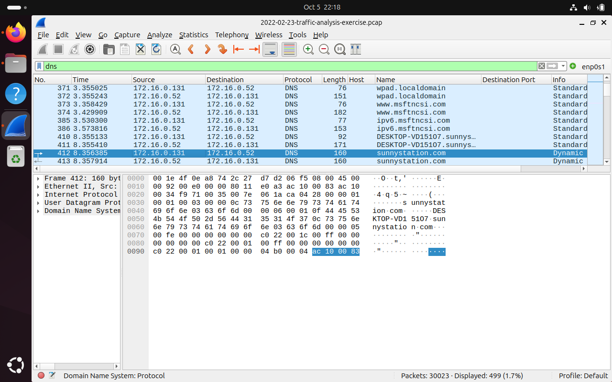
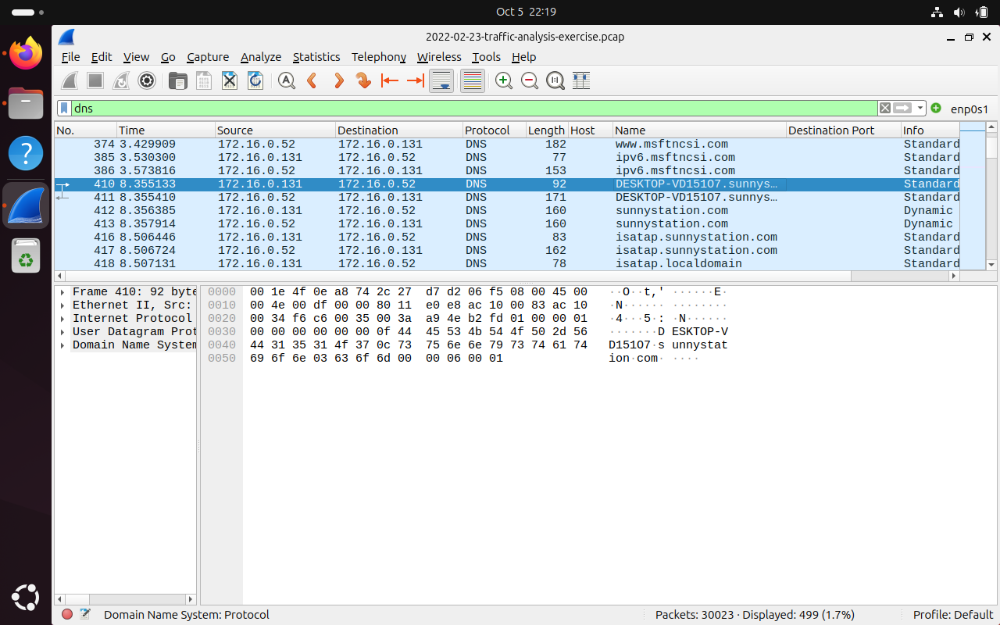
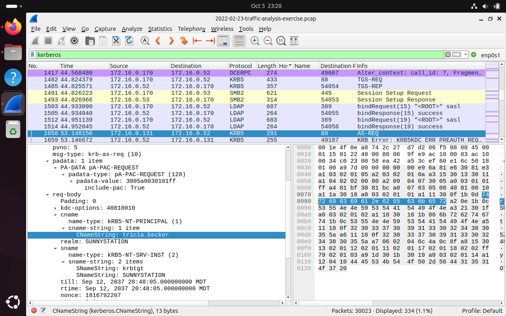
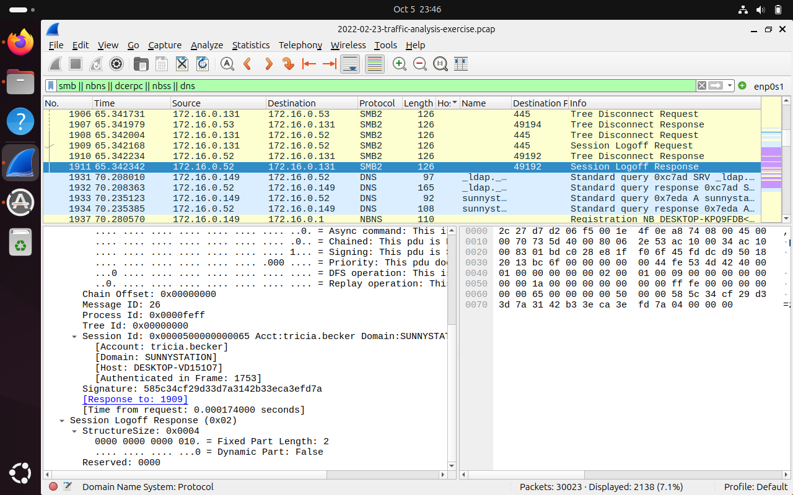
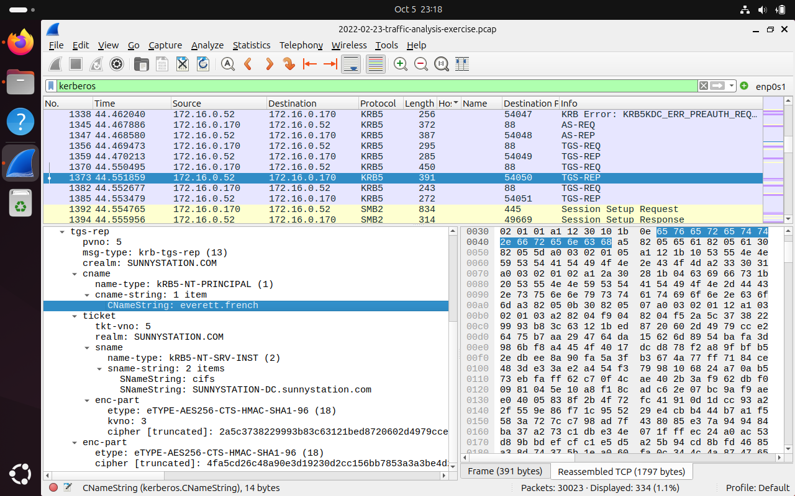
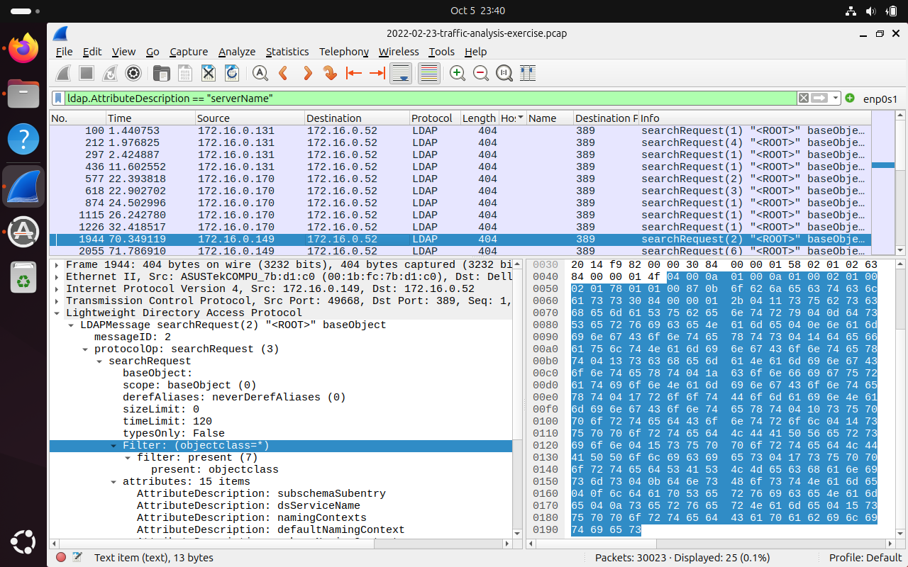
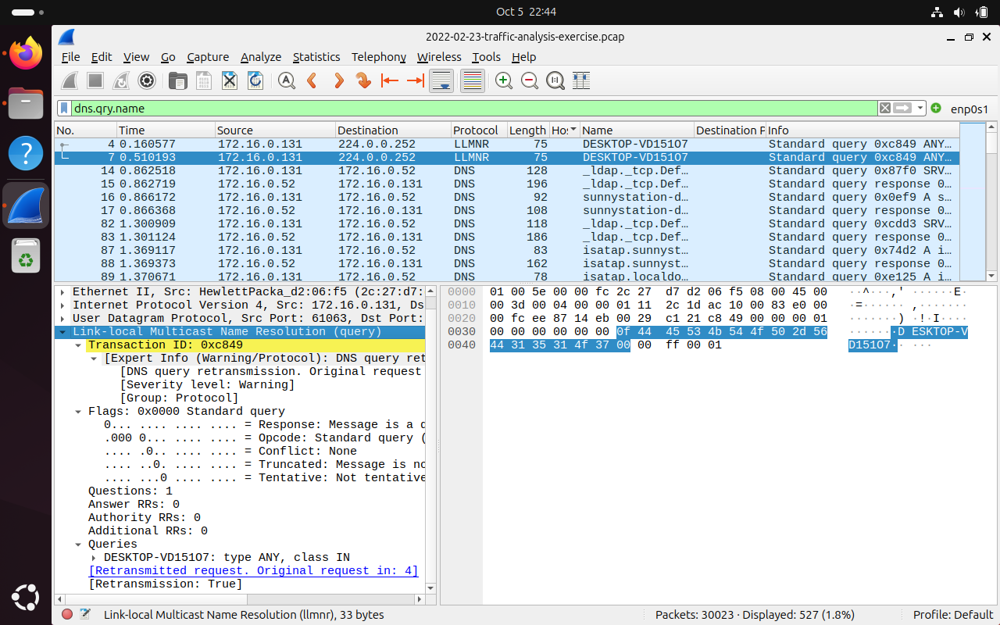
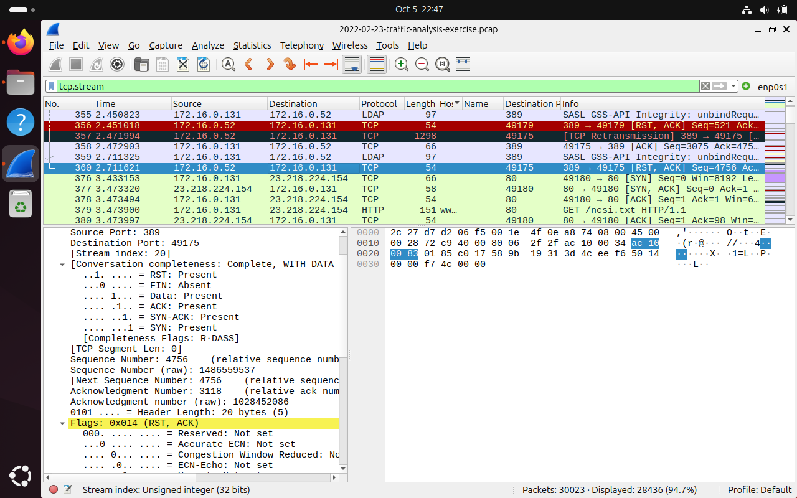
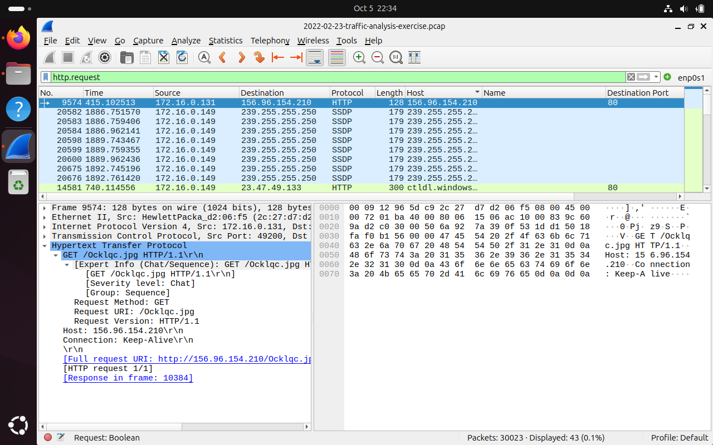
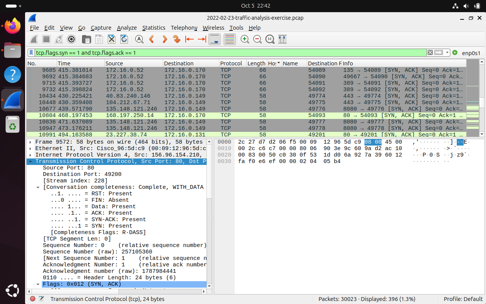

# Case 01 — Sunnystation: AD host & user attribution + suspicious raw-IP download

| | |
|---|---|
| **Evidence** | `2022-02-23-traffic-analysis-exercise.pcap` (30,023 packets) |
| **Source** | Public training exercise from [malware-traffic-analysis.net](https://www.malware-traffic-analysis.net/training-exercises.html) (PCAP not committed to this repo) |
| **Environment** | Active Directory domain `SUNNYSTATION` / `sunnystation.com`, subnet `172.16.0.0/24` |
| **Tools** | Wireshark display filters, manual protocol decoding (DNS, LLMNR, NBNS, Kerberos, SMB2, LDAP, HTTP, TCP) |
| **Verdict** | **Suspicious — likely malicious download on DESKTOP-VD15107 (tricia.becker).** Payload not yet confirmed. |

> All times are Wireshark's relative "seconds since start of capture". The dates in the screenshot title bars are when I did the analysis, not when the incident happened.

---

## 1. Executive summary

A Windows workstation, **DESKTOP-VD15107 (172.16.0.131)**, logged in as domain user **tricia.becker**, made an HTTP request at **415.10 s** for a randomly named "image" file (`/Ocklqc.jpg`) directly from the external IP **156.96.154.210**. The request didn't use a domain name, had **no User-Agent header**, and went over unencrypted HTTP. These are classic signs of a malware downloader, not a person using a web browser.

I also mapped every other host and account in the capture: two more workstations, the domain controller and a second file server. That gives the scope an incident responder needs before they start containment.

## 2. Assets identified

| IP | MAC (vendor) | Hostname | User account | Role | How I identified it |
|---|---|---|---|---|---|
| **172.16.0.131** | 2c:27:d7:d2:06:f5 (Hewlett-Packard) | **DESKTOP-VD15107** | **tricia.becker** | Workstation (**suspected victim**) | DNS dynamic update, Kerberos AS-REQ, SMB2 session |
| 172.16.0.170 | — | not identified | everett.french | Workstation | Kerberos TGS-REP |
| 172.16.0.149 | 00:1b:fc:7b:d1:c0 (ASUSTek) | DESKTOP-KPQ9FDB | not identified | Workstation | NBNS registration, LDAP rootDSE query |
| 172.16.0.52 | — | SUNNYSTATION-DC | — | Domain controller, DNS, file share | DNS server, KDC, `cifs/SUNNYSTATION-DC` SPN |
| 172.16.0.53 | — | — | — | SMB file server | SMB2 sessions from clients |

## 3. Analysis walkthrough

### 3.1 Mapping hostname ↔ IP (DNS)
Filter: `dns`

The DNS server **172.16.0.52** answers queries from 172.16.0.131. **Frame 412** (8.36 s) is a **DNS Dynamic Update** for zone `sunnystation.com`, and the record decodes to `172.16.0.131`. In other words, the host is registering its own A record. Frame 410 is the query for `DESKTOP-VD15107.sunnystation.com` that Windows sends right before that registration. Together they tie **DESKTOP-VD15107 → 172.16.0.131**.

### 3.2 Mapping user ↔ host (Kerberos + SMB2)
Filters: `kerberos`, `smb || nbns || dcerpc || nbss || dns`

* **Kerberos AS-REQ, frame 1658 (53.15 s):** 172.16.0.131 → DC with `CNameString: tricia.becker`, realm `SUNNYSTATION`.
* **SMB2 Session Logoff, frame 1911 (65.34 s):** Wireshark decodes the session as `Acct: tricia.becker, Domain: SUNNYSTATION, Host: DESKTOP-VD15107`. That's a second, independent source confirming the same user on the same host.

### 3.3 Second user (Kerberos TGS-REP)
**Frame 1373 (44.55 s)** is a TGS-REP from the DC to **172.16.0.170** for principal **everett.french** (realm `SUNNYSTATION.COM`). The ticket is for service `cifs/SUNNYSTATION-DC.sunnystation.com`, which confirms SUNNYSTATION-DC is the domain controller *and* a file-share server. Encryption type is AES256-CTS-HMAC-SHA1-96 (etype 18).

### 3.4 Third workstation (LDAP + NBNS)
Filter: `ldap.AttributeDescription == "serverName"`

**Frame 1944 (70.35 s):** 172.16.0.149 sends an LDAP rootDSE `searchRequest` to the DC on port 389, asking for `subschemaSubentry`, `dsServiceName`, `namingContexts`, `defaultNamingContext`. This is normal Windows domain discovery. At about the same time (70.2 s) the same host queries DNS for the `_ldap._tcp` SRV record and sends an **NBNS registration for DESKTOP-KPQ9FDB** (frame 1937).

### 3.5 Baseline / early-capture activity
* **LLMNR (frame 4, 0.16 s):** 172.16.0.131 sends an LLMNR query of type ANY for its own name to `224.0.0.252`. Frame 7 is a retransmission with the same transaction ID `0xc849`. This is normal Windows startup behavior, **but LLMNR is a protocol attackers on the same subnet can poison** (see recommendations).
* **LDAP reset (frames 356–360, ~2.5 s):** the DC resets an LDAP connection from .131 (TCP retransmission + RST/ACK).
* **NCSI (frame 379, 3.47 s):** `GET /ncsi.txt` to 23.218.224.154. This is Windows checking its internet connection and is benign.

### 3.6 Suspicious external download
Filter: `http.request`

Most HTTP in the capture is noise: SSDP discovery from 172.16.0.149 to `239.255.255.250`, and a Windows Update certificate-list request to `ctldl.windowsupdate.com`. One request stands out:

| Field | Value |
|---|---|
| Frame / time | **9574 / 415.10 s** (response in frame 10384) |
| Source | 172.16.0.131:49200 (DESKTOP-VD15107) |
| Destination | **156.96.154.210:80** |
| Request | `GET /Ocklqc.jpg HTTP/1.1` |
| Headers | `Host: 156.96.154.210`, `Connection: Keep-Alive` — **nothing else** |

**Why it's suspicious**
1. **Raw IP in the Host header**: no domain name, so DNS-based defenses never see it.
2. **No User-Agent**: real browsers always send one. Simple malware downloaders often don't.
3. **Random-looking file name** (`Ocklqc.jpg`). Over unencrypted HTTP, an executable or encoded payload can easily be disguised as an image.

Filter `tcp.flags.syn == 1 and tcp.flags.ack == 1` shows **frame 9572**, the SYN/ACK from 156.96.154.210:80. The server accepted the connection, and Wireshark's conversation completeness (`R-DASS`) shows that **data was exchanged** before the stream was reset.

## 4. Timeline (relative seconds)

| Time (s) | Frame | Event |
|---|---|---|
| 0.16 | 4 | .131 LLMNR query for its own name (DESKTOP-VD15107) |
| 2.45–2.71 | 356–360 | DC resets an LDAP session from .131 |
| 3.47 | 379 | .131 NCSI connectivity check (benign) |
| 8.36 | 412 | .131 DNS dynamic update → DESKTOP-VD15107.sunnystation.com |
| 44.55 | 1373 | TGS-REP for **everett.french** (.170), service cifs/SUNNYSTATION-DC |
| 53.15 | 1658 | Kerberos AS-REQ for **tricia.becker** from .131 |
| 65.34 | 1911 | SMB2 session logoff: tricia.becker @ DESKTOP-VD15107 |
| 70.2–70.35 | 1931–1944 | .149 (DESKTOP-KPQ9FDB) joins: DNS SRV, NBNS registration, LDAP rootDSE |
| **~415.1** | **9572** | **SYN/ACK from 156.96.154.210:80 to .131** |
| **415.10** | **9574** | **.131 → `GET /Ocklqc.jpg` (raw IP, no User-Agent)** |

## 5. Indicators of compromise

| Type | Value | Context |
|---|---|---|
| IP | `156.96.154.210` | HTTP server delivering `/Ocklqc.jpg` |
| URL | `hxxp://156.96.154.210/Ocklqc[.]jpg` | Suspected payload download (defanged) |
| Host | DESKTOP-VD15107 / 172.16.0.131 / 2c:27:d7:d2:06:f5 | Suspected victim |
| Account | SUNNYSTATION\tricia.becker | Logged-in user on the victim |

## 6. MITRE ATT&CK mapping (suspected — to be validated)

| Technique | Why |
|---|---|
| [T1105 Ingress Tool Transfer](https://attack.mitre.org/techniques/T1105/) | File pulled from an external raw IP by a non-browser client |
| [T1071.001 Application Layer Protocol: Web Protocols](https://attack.mitre.org/techniques/T1071/001/) | Plain HTTP used for the download channel |
| [T1036 Masquerading](https://attack.mitre.org/techniques/T1036/) | Payload possibly disguised with a `.jpg` extension (unconfirmed until the object is extracted) |
| *Exposure:* [T1557.001 LLMNR/NBT-NS Poisoning](https://attack.mitre.org/techniques/T1557/001/) | LLMNR in use on the subnet. Not observed being abused, but an open risk |

## 7. Recommendations

* **Contain** DESKTOP-VD15107: isolate the host, collect memory/disk, and reset tricia.becker's credentials.
* **Block** 156.96.154.210 at the perimeter and search proxy/firewall logs for any other host contacting it.
* **Disable LLMNR and NBT-NS** through Group Policy. Both are common spoofing targets on a local network.
* **Alert** on HTTP requests to raw external IPs, and on HTTP requests with no User-Agent, in proxy/IDS logs.
* **Monitor** DNS, proxy and HTTP logs for rare external IPs and periodic, beacon-like connections.
* Since the initial trigger is unknown, **reinforce phishing and safe-download training** for all users.

## 8. Lessons learned & open leads

What I'd do differently next time: **export HTTP objects and follow streams earlier, record a SHA-256 hash for every file, and note frame numbers as I go** so the timeline is easier to rebuild.

Open leads I could see in my screenshots but haven't investigated yet:

- [ ] Export `/Ocklqc.jpg` (*File → Export Objects → HTTP*) **inside an isolated VM**, check its real file type (`file`), hash it, and look up the hash.
- [ ] 172.16.0.149 gets repeated SYN/ACKs from **135.148.121.246:8080** (frames 10677, 10836, 10947, ~440–473 s). Port 8080 to an external IP is unusual and deserves a look.
- [ ] Other external connections after the download: 168.197.250.14:80 → .170 (468.2 s), 23.227.38.74:80 → .131 (494.2 s).
- [ ] Run [`pcap_triage.py`](../../tools/pcap_triage.py) on the capture and compare its output with this manual analysis.
