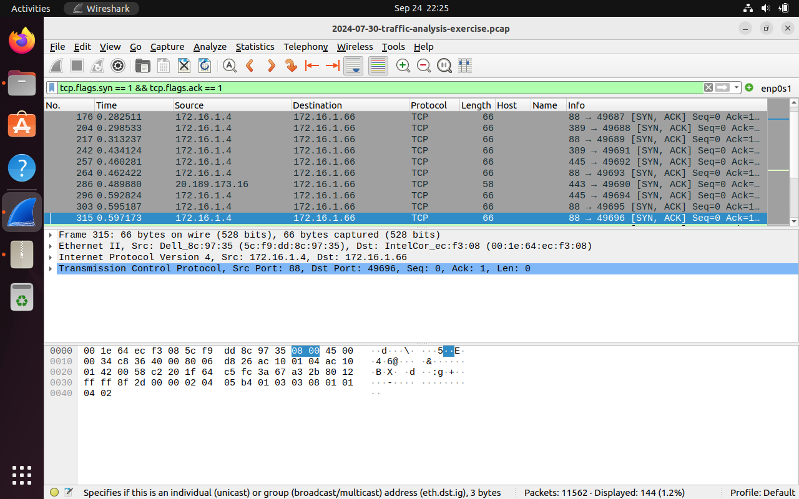
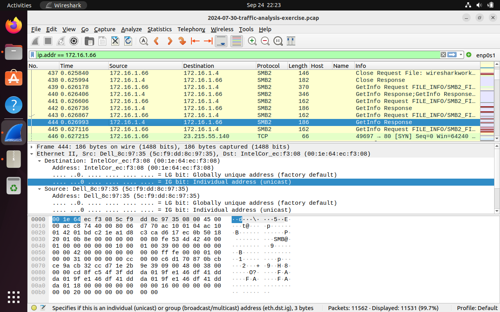
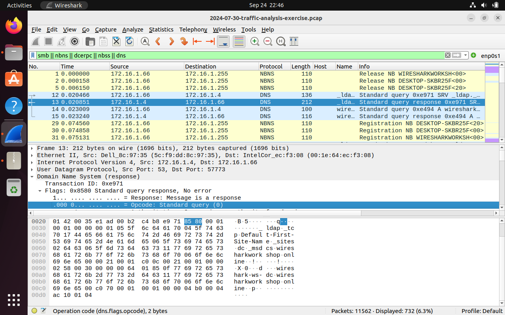
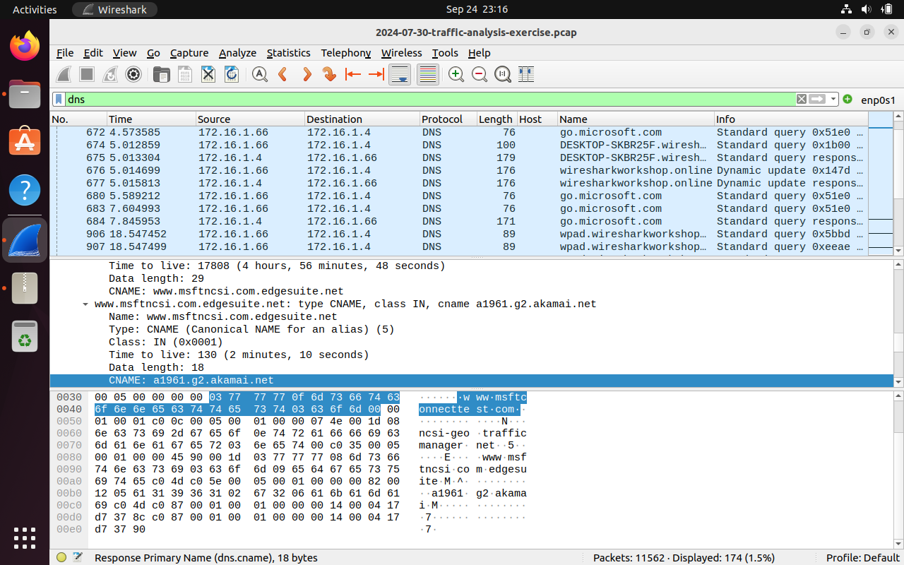
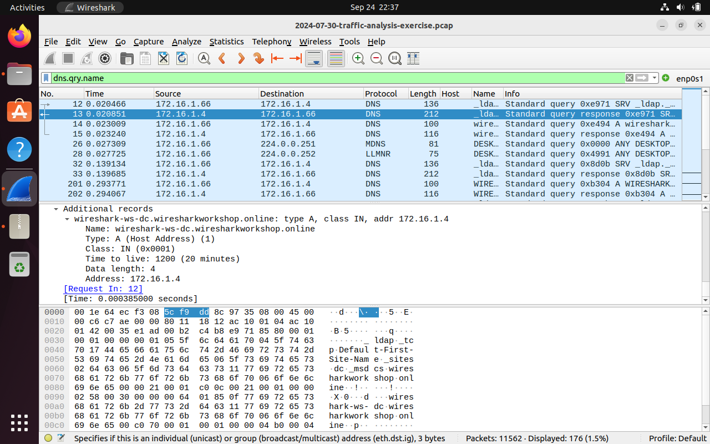
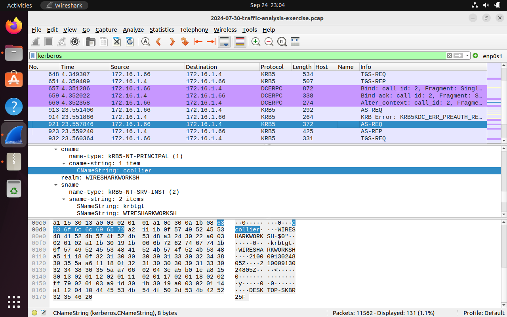
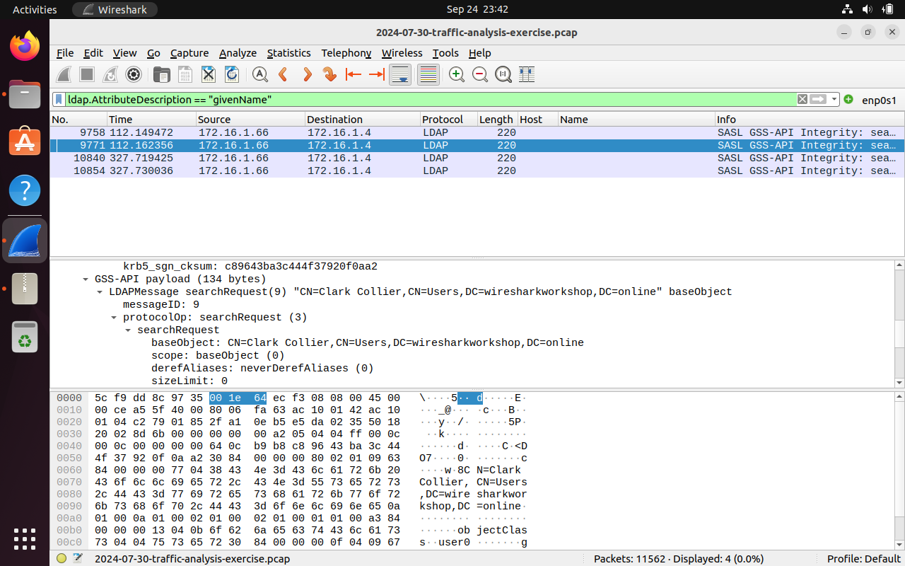
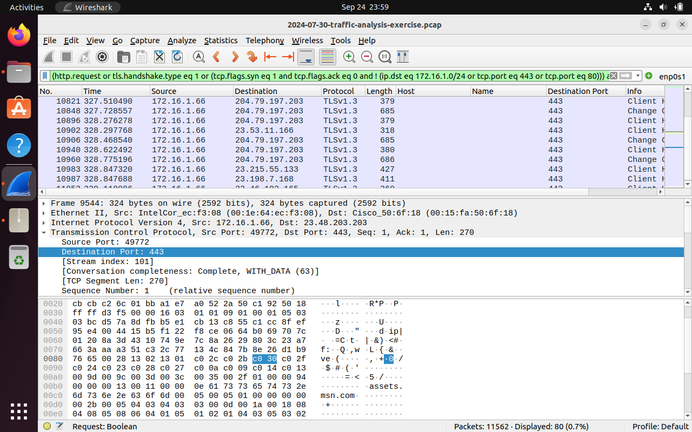
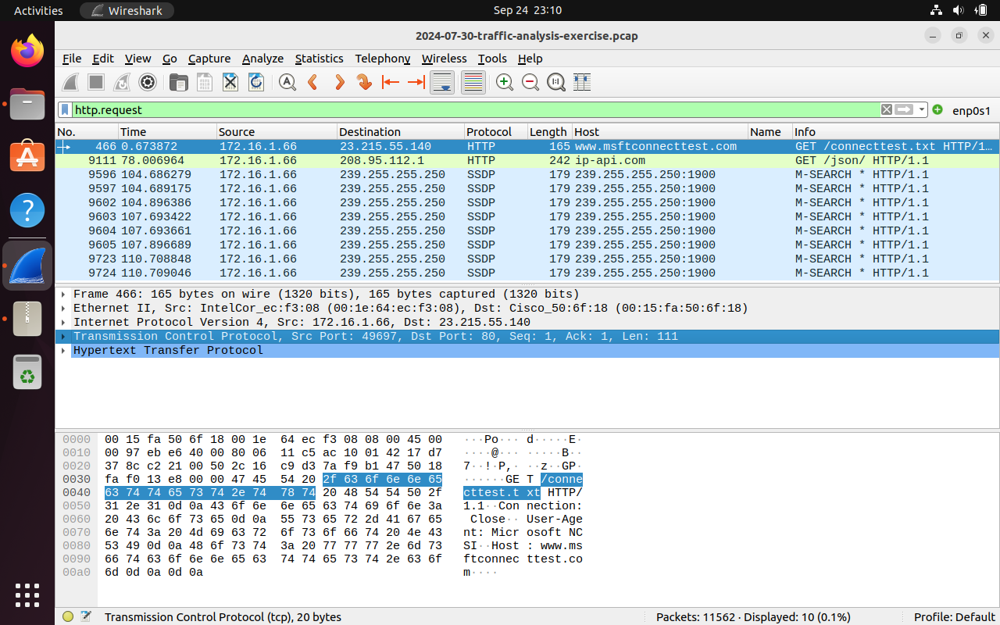
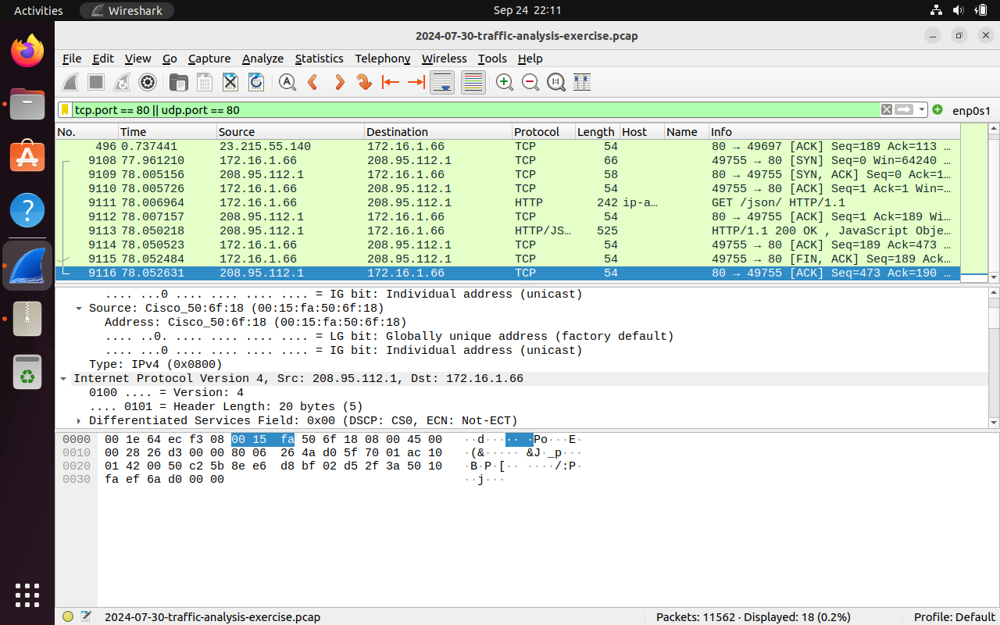

# Case 02 — Wiresharkworkshop: identifying the infected Windows host and user

| | |
|---|---|
| **Evidence** | `2024-07-30-traffic-analysis-exercise.pcap` (11,562 packets) |
| **Source** | Public training exercise from [malware-traffic-analysis.net](https://www.malware-traffic-analysis.net/training-exercises.html) (PCAP not committed to this repo) |
| **Environment** | Active Directory domain `WIRESHARKWORKSHOP` / `wiresharkworkshop.online`, subnet `172.16.1.0/24` |
| **Task** | Identify the victim's hostname, IP address, MAC address and Windows user account |
| **Tools** | Wireshark display filters, custom columns, Kerberos/LDAP/NBNS/DNS decoding |

---

## 1. Answer

| Field | Value | Evidence |
|---|---|---|
| **Hostname** | **DESKTOP-SKBR25F** | NBNS registration (frames 29–31) and DNS dynamic update (frames 676–677) |
| **IP address** | **172.16.1.66** | SYN/ACKs from the DC to this host; source of all client traffic |
| **MAC address** | **00:1e:64:ec:f3:08** (Intel) | Ethernet header of the host's frames |
| **Windows account** | **ccollier** (full name **Clark Collier**) | Kerberos AS-REQ `CNameString` + LDAP `CN=Clark Collier,CN=Users,...` |
| Domain controller | 172.16.1.4 — `wireshark-ws-dc.wiresharkworkshop.online` (MAC 5c:f9:dd:8c:97:35, Dell) | DNS SRV answer for `_ldap._tcp`, KDC for Kerberos |
| Default gateway | MAC 00:15:fa:50:6f:18 (Cisco) | Destination MAC for internet-bound traffic |

## 2. How I found each answer

### 2.1 IP and MAC address
Filters: `tcp.flags.syn == 1 && tcp.flags.ack == 1`, then `ip.addr == 172.16.1.66`

The SYN/ACK filter shows which hosts servers are answering. The DC (172.16.1.4) repeatedly answers **172.16.1.66** on Kerberos (88), LDAP (389) and SMB (445). Expanding any of these frames, the Ethernet destination is `IntelCor_ec:f3:08` → **00:1e:64:ec:f3:08**. Filtering on `ip.addr == 172.16.1.66` confirms nearly the whole capture (11,531 of 11,562 packets) involves this one host.




### 2.2 Hostname
Filters: `dns` (with the DNS query **Name added as a column**), `smb || nbns || dcerpc || nbss || dns`

* **NBNS (frames 29–31):** 172.16.1.66 broadcasts `Registration NB DESKTOP-SKBR25F<20>` and `<00>` to 172.16.1.255.
* **DNS dynamic update (frames 676–677, ~5.0 s):** the host registers `DESKTOP-SKBR25F.wiresharkworkshop.online` with the DC.
* **DNS SRV answer (frame 13):** the response to `_ldap._tcp.Default-First-Site-Name._sites.dc._msdcs...` returns `wireshark-ws-dc.wiresharkworkshop.online → 172.16.1.4`, which identifies the domain controller.





### 2.3 User account
Filters: `kerberos`, then `ldap.AttributeDescription == "givenName"`

* **Kerberos AS-REQ (frame 921, 23.56 s):** `CNameString: ccollier`, realm `WIRESHARKWORKSHOP`, requesting `krbtgt`. This is the user logging in.
* **LDAP searchRequest (frames 9758–10854, ~112 s and ~327 s):** the client queries its own user object, `baseObject: CN=Clark Collier,CN=Users,DC=wiresharkworkshop,DC=online`, which gives the **full name** behind the account.




## 3. Web activity

Filter (a "web traffic" view: HTTP requests, TLS Client Hellos, and outbound SYNs on unusual ports):
```
(http.request or tls.handshake.type eq 1 or (tcp.flags.syn eq 1 and tcp.flags.ack eq 0 and !(ip.dst eq 172.16.1.0/24 or tcp.port eq 443 or tcp.port eq 80))) and !(ssdp)
```
*(The end of the filter is cut off in my screenshot. `and !(ssdp)` is how I hide SSDP noise.)*


Then `http.request` and `tcp.port == 80 || udp.port == 80`:

| Frame | Time (s) | Request | Assessment |
|---|---|---|---|
| 466 | 0.67 | `GET /connecttest.txt` → www.msftconnecttest.com (User-Agent: Microsoft NCSI) | Benign: Windows checking its internet connection |
| **9111** | **78.01** | **`GET /json/` → ip-api.com (208.95.112.1)**, answered with `HTTP/1.1 200 OK` + JSON (frame 9113) | **Suspicious**: see below |
| 9596+ | ~104 s | SSDP `M-SEARCH` to 239.255.255.250 | Benign LAN discovery noise |




**Why `ip-api.com/json/` matters:** it returns the caller's public IP, country, city and ISP. Normal users rarely hit this endpoint over plain HTTP. **Many infostealers and RATs call IP-geolocation services right after infection** to fingerprint the victim, and some use the answer to decide whether to keep running. This is a lead, not proof. Confirming it needs the process that made the request (host EDR/Sysmon logs) or the traffic that comes before and after it.

## 4. Indicators & ATT&CK (suspected — to be validated)

| Type | Value | Context |
|---|---|---|
| Host | DESKTOP-SKBR25F / 172.16.1.66 / 00:1e:64:ec:f3:08 | Suspected victim |
| Account | WIRESHARKWORKSHOP\ccollier (Clark Collier) | Logged-in user |
| URL | `hxxp://ip-api[.]com/json/` | IP-geolocation lookup at 78.01 s |

| Technique | Why |
|---|---|
| [T1614 System Location Discovery](https://attack.mitre.org/techniques/T1614/) | Geolocation lookup of the host's public IP (if attributed to malware) |

## 5. Recommendations
* Isolate DESKTOP-SKBR25F and reset ccollier's credentials until the source of the ip-api.com request is explained.
* Pull endpoint telemetry (Sysmon Event ID 3 / EDR network events) for 172.16.1.66 around 78 s into the capture to find the process behind the lookup.
* Add a detection for workstation requests to public IP-lookup services (`ip-api.com`, `ipinfo.io`, `api.ipify.org`, …), especially from non-browser processes.

## 6. Open leads
- [ ] Follow the TCP stream around frame 9111 and check what happened right before it (new external connections, downloads, TLS sessions).
- [ ] Review the TLS Client Hello server names in the web-traffic view for anything that isn't Microsoft/CDN.
- [ ] Run [`pcap_triage.py`](../../tools/pcap_triage.py) on the capture and compare its output with this manual analysis.
