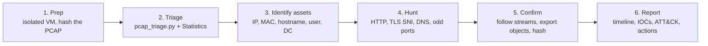

# PCAP investigation playbook

The repeatable process I follow for each case in this repo.

## 1. Prep
- [ ] Work in an **isolated VM**. Malware-traffic PCAPs can contain live malware.
- [ ] Record `sha256sum capture.pcap` so the evidence can be verified later.
- [ ] Note the capture's start time and the subnet (*Statistics → Capture File Properties*).

## 2. Triage (5 minutes)
- [ ] `python tools/pcap_triage.py capture.pcap -o triage.md --iocs iocs.csv`
- [ ] *Statistics → Protocol Hierarchy*: what protocols are present?
- [ ] *Statistics → Conversations → IPv4/TCP*: top talkers and external endpoints.

## 3. Identify assets
| Question | Where to look |
|---|---|
| Victim IP | Host with the most traffic, or the client side of suspicious HTTP |
| MAC | Ethernet source of that IP's frames |
| Hostname | NBNS registration, DNS dynamic update, DHCP option 12 |
| User | Kerberos AS-REQ `CNameString` (ignore `$` accounts), SMB2 session, LDAP `CN=` |
| Domain controller | Host answering on 88 (Kerberos) + 389 (LDAP) + 53 (DNS) |

## 4. Hunt (red flags)
- HTTP **Host header is a raw IP**
- **No User-Agent**, or a scripting User-Agent (`curl`, `PowerShell`, `python-requests`, `WinHTTP`)
- Random-looking filenames, or an image/document extension on a file that is really an executable
- **IP-geolocation lookups** (`ip-api.com`, `ipinfo.io`, `api.ipify.org`)
- Repeated connections at regular intervals to one external IP (**beaconing**)
- External connections on unusual ports (e.g. 8080, 4444, 8443 to raw IPs)
- New or rare TLS SNI domains, or self-signed certificates

## 5. Confirm
- Follow the TCP stream. Export the HTTP object, run `file` on it, hash it, and look the hash up.
- Check whether the victim's traffic changes **after** the suspicious event (new destinations, beacons).

## 6. Report
Use the structure from the case reports: **summary → assets → walkthrough with screenshots → timeline → IOCs (defanged) → ATT&CK → recommendations → lessons learned.**
